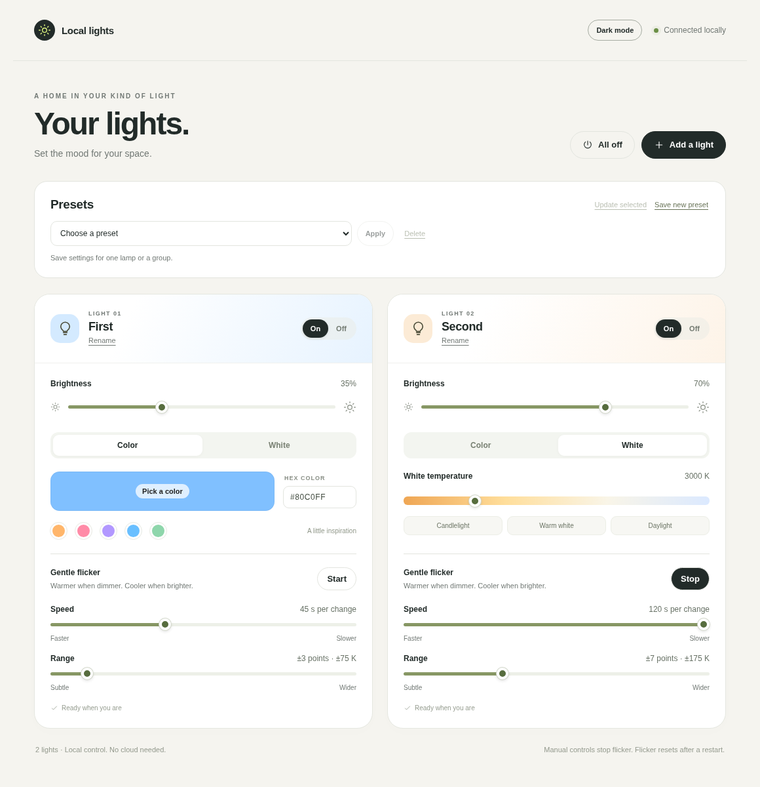
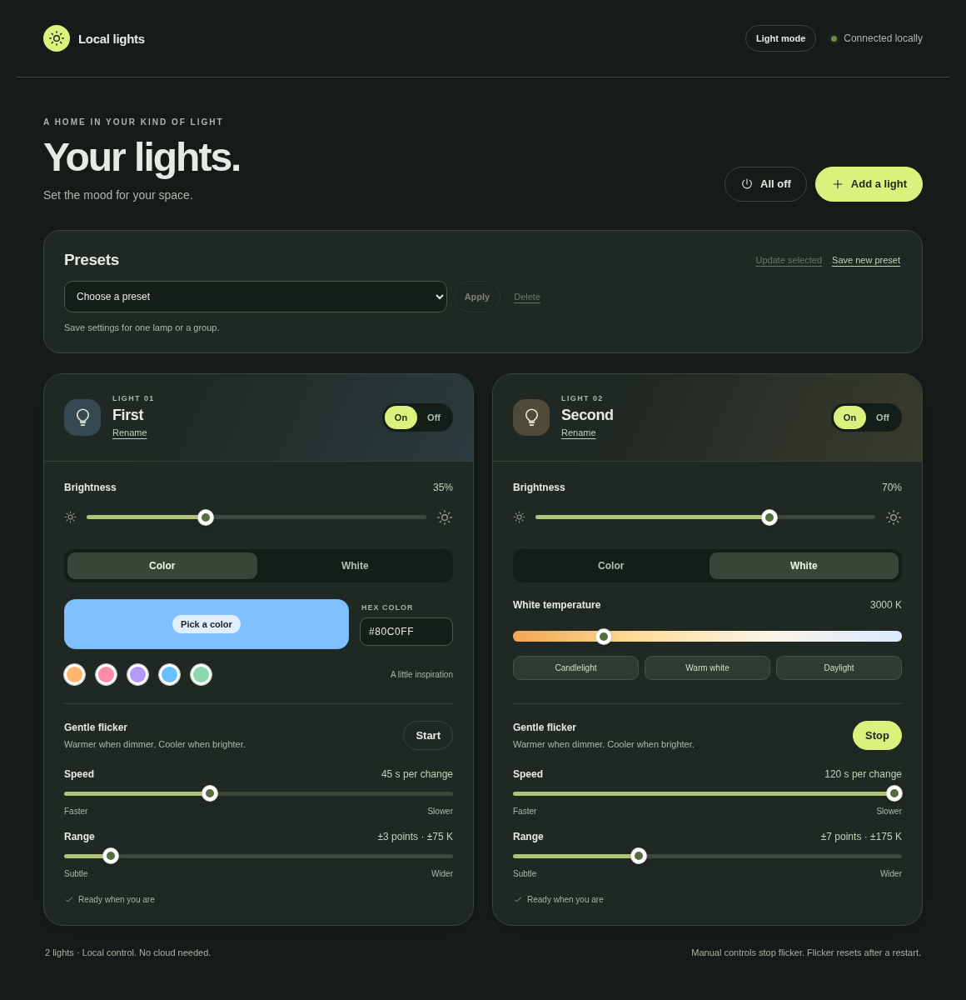

# Local lights

A Matter light controller that runs entirely on an ESP32. It pairs Matter bulbs
directly, serves its own control page over Wi-Fi, and needs no cloud account, hub or
phone app.

<p>
  
  
</p>

## What it does

- **Pairs bulbs by Matter setup code**, from the web page. Paired bulbs are stored on
  the ESP32 and survive firmware upgrades.
- **Controls each light**: power, brightness, white temperature (2000 to 6500 K) and colour.
- **Presets**: save the state of one lamp or a group and apply it later. Stored on the controller.
- **Flicker**: an optional candle-style flicker per lamp, with speed and range settings.
- **One page, no dependencies**: the whole UI is a single HTML file compiled into the
  firmware, with light and dark themes.

## How it works

```
Browser  ──HTTP──▶  ESP32  ──Matter over Wi-Fi──▶  Bulbs
                    │
                    ├─ esp-matter controller (commissioner)
                    ├─ HTTP server + JSON API   (firmware/main/local_web.cpp)
                    └─ the web page             (web/index.html, embedded)
```

Bluetooth is only used while pairing a new bulb. Outside pairing mode it is shut down to
free memory, which is why adding a light restarts the controller briefly.

## Layout

```
firmware/            ESP-IDF project (target: esp32)
  main/app_main.cpp    starts Matter and the controller
  main/local_web.cpp   HTTP API, bulb and preset storage, flicker
  main/web_page.h      generated from web/index.html
web/index.html       the control page
generate_web.py      embeds web/index.html into firmware/main/web_page.h
esp-matter-local.patch   small patch applied to esp-matter (controller commands)
board_console.py     capture boot logs / send Wi-Fi settings over USB serial
tests/               UI checks (Playwright) and checks against a live controller
docs/API.md          the HTTP API
```

## Building

Built against **ESP-IDF v5.4.1** and **esp-matter `release/v1.4`**.

```sh
# with ESP-IDF and esp-matter set up and exported
cd path/to/esp-matter && git apply path/to/local-lights/esp-matter-local.patch

python3 generate_web.py                 # after any change to web/index.html
cd firmware
idf.py set-target esp32
idf.py build
idf.py -p <PORT> flash monitor
```

Connect the controller to Wi-Fi once from its serial console:

```
matter esp wifi connect <ssid> <password>
```

Then open the controller's IP address in a browser and use **Add a light**.

`idf.py erase-flash` wipes the paired bulbs. A normal `flash` keeps them.

## API

See [docs/API.md](docs/API.md).

## Tests

`tests/ui_check.py` and `tests/presets_ui_check.py` drive the page in a browser against
mock data. The `*_device_check.py` scripts talk to a real controller; set `BASE` at the
top of each to your controller's address.

## Licence

MIT, see [LICENSE](LICENSE). `firmware/` started from Espressif's esp-matter controller
example, which is Apache-2.0; `firmware/paa_cert/` holds the Matter attestation root
certificates shipped with that example.
